<p align="center">
  
</p>

<h1 align="center">MetalReel</h1>

<p align="center"><b>A native macOS renderer for Remotion projects. Your code stays the same, Chrome is not needed, and it runs on Apple's own engines.</b><br>
JavaScriptCore · Yoga · Core Text · Metal · VideoToolbox</p>

<p align="center">
  <a href="#quick-start">Quick start</a> ·
  <a href="#benchmarks">Benchmarks</a> ·
  <a href="#before--after">Before / after</a> ·
  <a href="#what-makes-it-different">Features</a> ·
  <a href="#compatibility">Compatibility</a> ·
  <a href="#roadmap">Roadmap</a> ·
  <a href="docs/ARCHITECTURE.md">Architecture</a>
</p>

---

[Remotion](https://www.remotion.dev) lets you build videos with React. To turn them into an MP4, it opens your
composition in headless Chrome, takes a screenshot of every frame, and sends the screenshots to FFmpeg.
That works everywhere, but on a Mac most of the time goes to the browser. The GPU and the hardware video
engines sit mostly idle.

MetalReel runs **the same Remotion bundle** in JavaScriptCore with a small React host renderer. It lays the
page out with Yoga and Core Text, paints with Core Image on Metal, and decodes and encodes on the media
engines through VideoToolbox. Pixels go from GPU memory to the encoder without a copy.

```bash
node js/cli/metalreel.mjs render MyComposition --project ~/my-remotion-app
```

<!-- RESULTS:START -->
**Measured on an Apple M5 Max (macOS 27), 12 sample compositions in [`examples/`](examples):** native mode rendered **2.5–6.1× faster** than `npx remotion render` and used **5–41× less CPU time**. On the 5-minute composition (9,000 frames): Remotion 126 s, hybrid 41 s, native 33 s. Mean pixel difference to Remotion's own output: **MAE 0.61–2.72** on a 0–255 scale. Details in [Benchmarks](#benchmarks).
<!-- RESULTS:END -->

> [!NOTE]
> MetalReel is a young, independent project. It is not affiliated with Remotion.
> Compositions that use canvas or WebGL should use [hybrid mode](#two-modes) for now.

## Quick start

Requirements: a Mac with Apple Silicon, macOS 15 or later, Xcode 16+ (Swift 6), and Node 20+.

```bash
git clone https://github.com/OWNER/metalreel.git && cd metalreel   # replace OWNER with the GitHub account that hosts the repository
cd js && npm install && node build.mjs && cd ..   # React host renderer + browser shims
swift build -c release                             # the native renderer
```

Render any Remotion project (`OWNER` above is a placeholder until the repository is published). It needs `@remotion/bundler` in its dependencies, which Remotion projects
already have through `@remotion/cli`.

```bash
node js/cli/metalreel.mjs render MyComposition --project ~/my-remotion-app
```

```bash
node js/cli/metalreel.mjs render MyComposition --project ~/my-remotion-app --frames 0-299 --codec hevc --out ~/Desktop/out.mp4
```

```bash
node js/cli/metalreel.mjs still MyComposition --project ~/my-remotion-app --frame 120 --png frame.png
```

Try the samples (they download about 190 MB of openly licensed clips first):

```bash
scripts/download-media.sh && (cd examples && npm install)
```

```bash
node js/cli/metalreel.mjs render TitleCard --project examples
```

Options: `--mode native|hybrid`, `--frames a-b`, `--props '{"name":"Sam"}'`, `--codec h264|hevc`,
`--bitrate 8M`, `--muted`, `--no-webkit`, `--dump-ops file.ndjson` (to inspect the display list).

## Two modes

| | **native** (default) | **hybrid** |
|---|---|---|
| JavaScript | JavaScriptCore, in-process | headless Chrome tabs |
| Layout and text | Yoga + Core Text | Chrome (computed styles + text boxes via CDP `DOMSnapshot`) |
| Painting | Metal (Core Image) | Metal (Core Image), the same painter |
| Screenshots | none | none; Chrome only produces a ~2 KB display list per frame |
| Video decode and encode | VideoToolbox | VideoToolbox |
| Best for | the vast majority of DOM/CSS compositions | canvas, WebGL/three.js, unusual CSS |

Both modes paint and encode identically, so you can switch per composition and compare.

Hybrid mode needs Chrome Headless Shell. If you don't pass `--chrome <path>` (or set `METALREEL_CHROME`), Remotion's `ensureBrowser()` downloads it once on first use. Native mode never starts a browser.

## Benchmarks

<p align="center">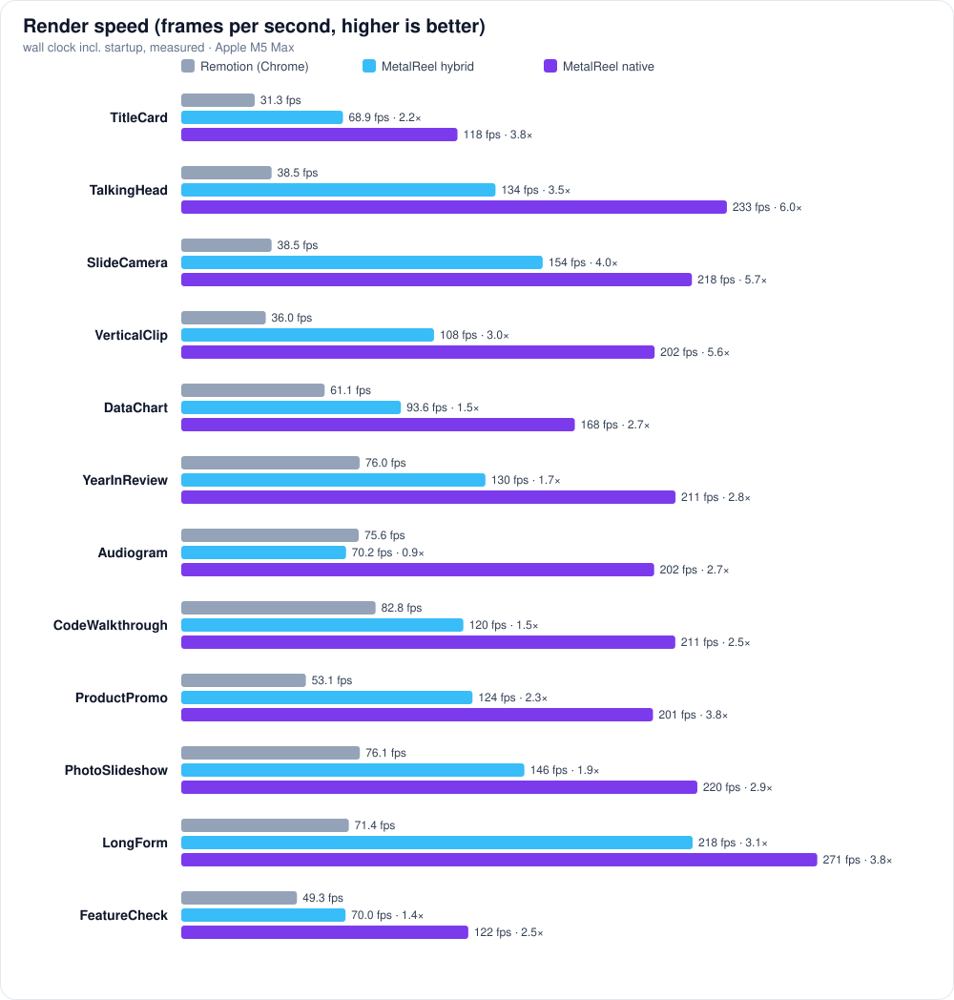</p>
<p align="center">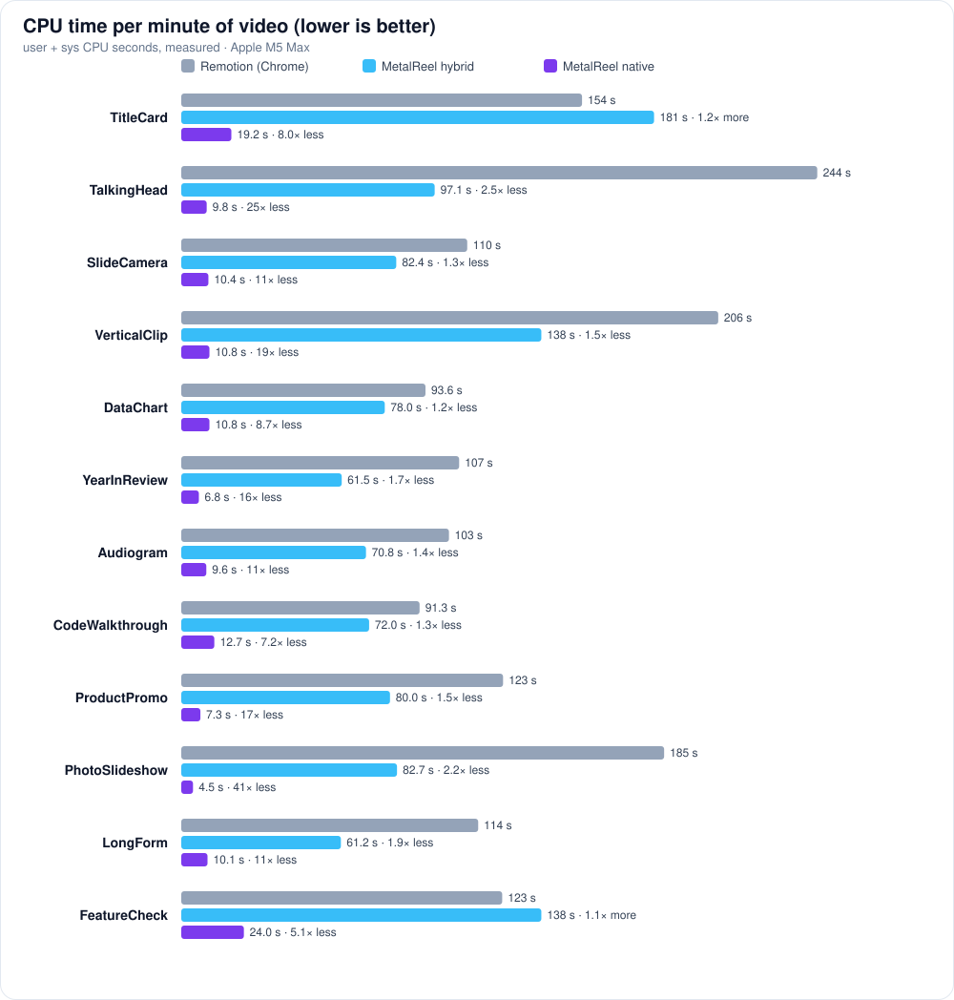</p>

<!-- BENCH:START -->
Machine: Apple M5 Max, macOS 27.0.0. Measured 2026-11-22.

| Composition | Mode | Frames | Wall (s) | FPS | Speed-up | CPU time (s) | GPU avg | Peak RSS (MB) | File (MB) |
|---|---|---|---|---|---|---|---|---|---|
| TitleCard | remotion | 150 | 4.8 | 31.3 | 1.0× | 12.8 | 5% | 1033 | 4.3 |
| TitleCard | hybrid | 150 | 2.18 | 68.9 | 2.2× | 15.1 | 25% | 507 | 3.8 |
| TitleCard | native | 150 | 1.27 | 117.7 | 3.8× | 1.6 | 33% | 594 | 3.8 |
| TalkingHead | remotion | 480 | 12.47 | 38.5 | 1.0× | 65 | 3% | 1049 | 24.6 |
| TalkingHead | hybrid | 480 | 3.58 | 133.9 | 3.5× | 25.9 | 26% | 558 | 12 |
| TalkingHead | native | 480 | 2.06 | 232.5 | 6.1× | 2.6 | 36% | 216 | 12.2 |
| SlideCamera | remotion | 450 | 11.69 | 38.5 | 1.0× | 27.4 | 3% | 1037 | 3.6 |
| SlideCamera | hybrid | 450 | 2.92 | 154 | 4.0× | 20.6 | 30% | 422 | 7.7 |
| SlideCamera | native | 450 | 2.07 | 217.6 | 5.6× | 2.6 | 30% | 229 | 7.5 |
| VerticalClip | remotion | 300 | 8.33 | 36 | 1.0× | 34.3 | 0% | 1040 | 11.1 |
| VerticalClip | hybrid | 300 | 2.79 | 107.7 | 3.0× | 23 | 36% | 492 | 7.7 |
| VerticalClip | native | 300 | 1.49 | 201.7 | 5.6× | 1.8 | 25% | 495 | 7.7 |
| DataChart | remotion | 150 | 2.45 | 61.1 | 1.0× | 7.8 | 0% | 1028 | 0.1 |
| DataChart | hybrid | 150 | 1.6 | 93.6 | 1.5× | 6.5 | 42% | 361 | 0.2 |
| DataChart | native | 150 | 0.89 | 167.7 | 2.8× | 0.9 | 66% | 169 | 0.3 |
| YearInReview | remotion | 240 | 3.16 | 76 | 1.0× | 14.2 | 2% | 1045 | 0.9 |
| YearInReview | hybrid | 240 | 1.85 | 129.6 | 1.7× | 8.2 | 29% | 471 | 1.6 |
| YearInReview | native | 240 | 1.14 | 210.6 | 2.8× | 0.9 | 7% | 451 | 1.5 |
| Audiogram | remotion | 300 | 3.97 | 75.6 | 1.0× | 17.1 | 0% | 1030 | 1.1 |
| Audiogram | hybrid | 300 | 4.27 | 70.2 | 0.9× | 11.8 | 37% | 478 | 2 |
| Audiogram | native | 300 | 1.49 | 201.5 | 2.7× | 1.6 | 56% | 201 | 3.1 |
| CodeWalkthrough | remotion | 270 | 3.26 | 82.8 | 1.0× | 13.7 | 2% | 1037 | 0.6 |
| CodeWalkthrough | hybrid | 270 | 2.25 | 120.2 | 1.4× | 10.8 | 29% | 409 | 1.7 |
| CodeWalkthrough | native | 270 | 1.28 | 210.5 | 2.5× | 1.9 | 39% | 250 | 1.7 |
| ProductPromo | remotion | 270 | 5.08 | 53.1 | 1.0× | 18.5 | 0% | 1054 | 7.2 |
| ProductPromo | hybrid | 270 | 2.18 | 124.1 | 2.3× | 12 | 25% | 586 | 3.7 |
| ProductPromo | native | 270 | 1.34 | 201 | 3.8× | 1.1 | 37% | 200 | 3.7 |
| PhotoSlideshow | remotion | 320 | 4.2 | 76.1 | 1.0× | 32.9 | 0% | 1103 | 5.9 |
| PhotoSlideshow | hybrid | 320 | 2.19 | 146.2 | 1.9× | 14.7 | 48% | 618 | 7.1 |
| PhotoSlideshow | native | 320 | 1.46 | 219.9 | 2.9× | 0.8 | 30% | 131 | 7.1 |
| LongForm | remotion | 9000 | 126 | 71.4 | 1.0× | 569 | 1% | 1036 | 162.7 |
| LongForm | hybrid | 9000 | 41.3 | 217.9 | 3.1× | 305.9 | 35% | 419 | 225.1 |
| LongForm | native | 9000 | 33.21 | 271 | 3.8× | 50.3 | 37% | 688 | 225 |
| FeatureCheck | remotion | 120 | 2.43 | 49.3 | 1.0× | 8.2 | 31% | 1029 | 0.2 |
| FeatureCheck | hybrid | 120 | 1.72 | 70 | 1.4× | 9.2 | 34% | 484 | 0.3 |
| FeatureCheck | native | 120 | 0.98 | 122.3 | 2.5× | 1.6 | 26% | 210 | 0.7 |
<!-- BENCH:END -->

Hybrid mode is not always faster than Remotion: on Audiogram it measured 0.9×. Native mode was faster on every sample.

**How it was measured.** `node scripts/bench.mjs` runs each composition from start to finish in each mode on
the same machine, one after another, and waits whenever macOS reports thermal throttling.

- *Wall* time includes startup: bundle cache lookup, JavaScriptCore boot or Chrome launch, encoding, and audio mux.
- *CPU time* is user + system from `/usr/bin/time -l`.
- *GPU* is the average of `IOAccelerator` "Device Utilization %", sampled every 250 ms.
- Remotion ran with its default settings (`npx remotion render`, x264 CRF 18). MetalReel uses VideoToolbox H.264 at 6 Mbps for 1080p.
- Raw numbers are in [`bench/results/results.json`](bench/results/results.json).

Everything in the tables above was **measured**. Statements about longer videos below are labeled *estimate*.

## Before / after

Same frame, same composition, same project. Left: MetalReel native. Right: `npx remotion still` (Chrome).
Each pair is followed by its difference heat map: black means identical, yellow means large differences.

<!-- COMPARE:START -->
| Composition (frame) | MetalReel native vs Remotion | Difference | MAE native | MAE hybrid |
|---|---|---|---|---|
| TitleCard (60) | 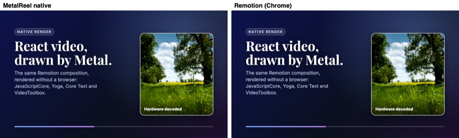 | 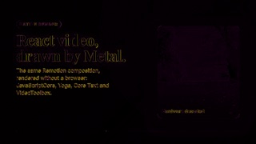 | 1.75 | 1.86 |
| TalkingHead (60) | 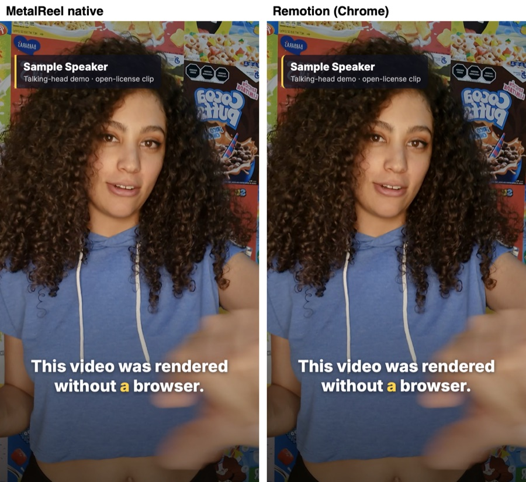 | 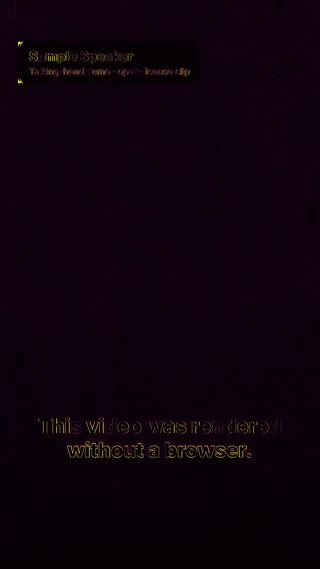 | 2.38 | 2.42 |
| TalkingHead (200) | 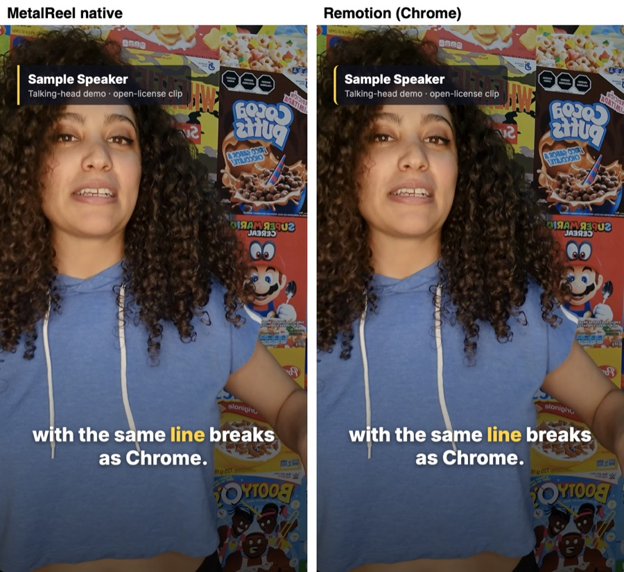 | 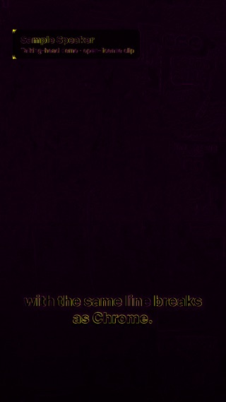 | 2.38 | 2.43 |
| SlideCamera (200) | 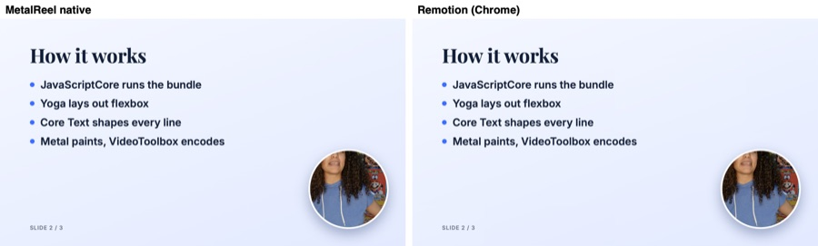 | 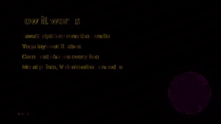 | 0.95 | 1.49 |
| VerticalClip (240) | 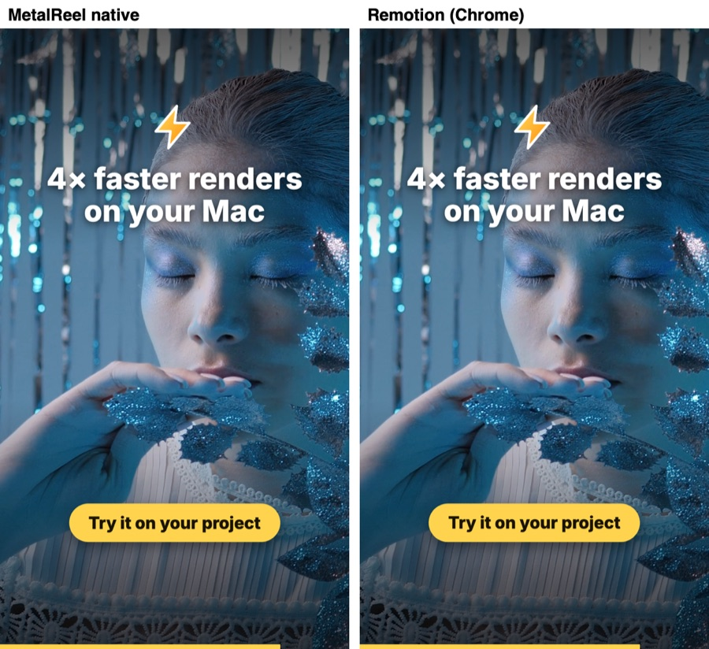 | 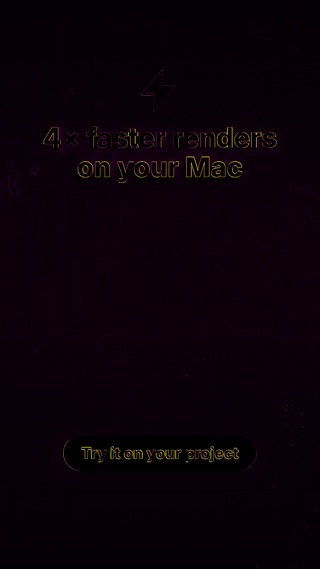 | 1.90 | 1.89 |
| DataChart (120) | 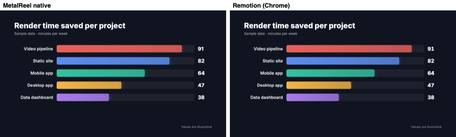 | 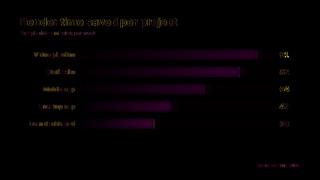 | 0.87 | 0.87 |
| YearInReview (100) | 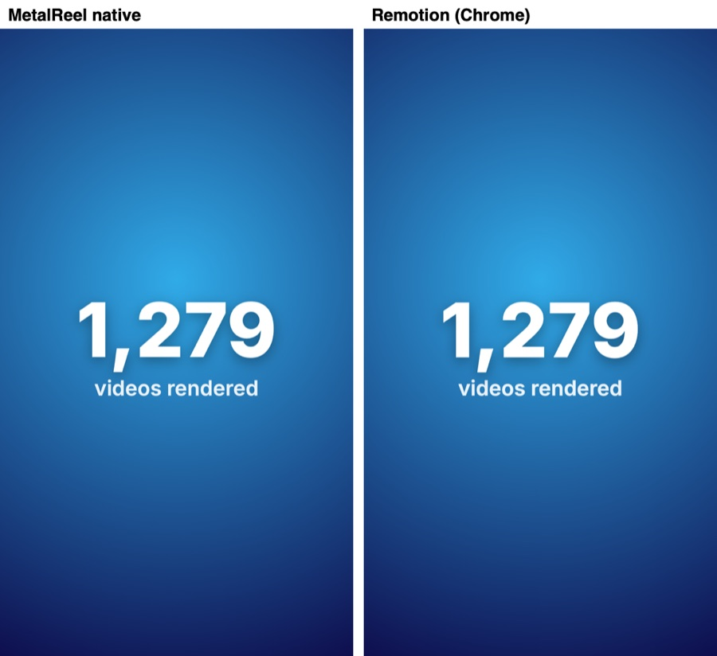 | 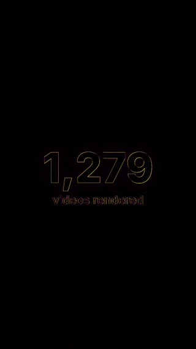 | 0.61 | 0.61 |
| Audiogram (60) | 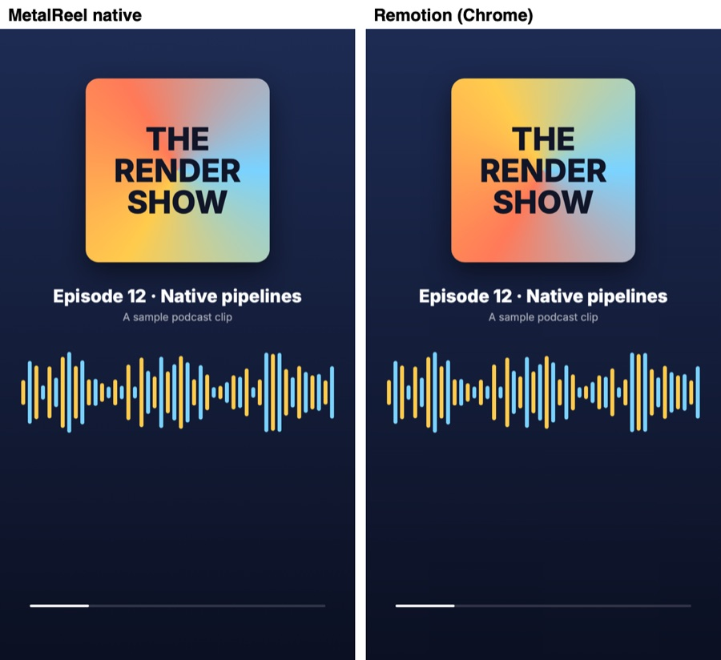 | 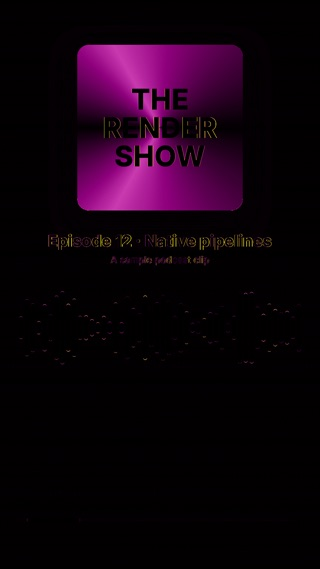 | 2.71 | 2.71 |
| CodeWalkthrough (200) | 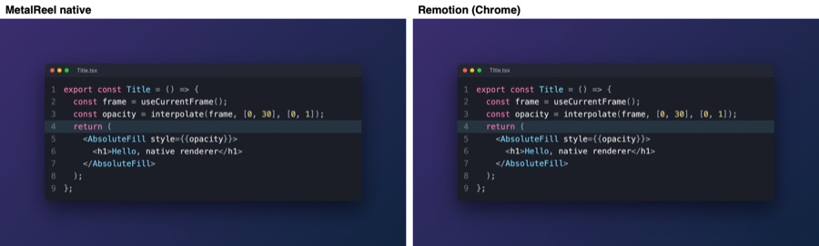 | 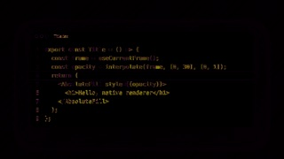 | 0.99 | 0.93 |
| ProductPromo (125) | 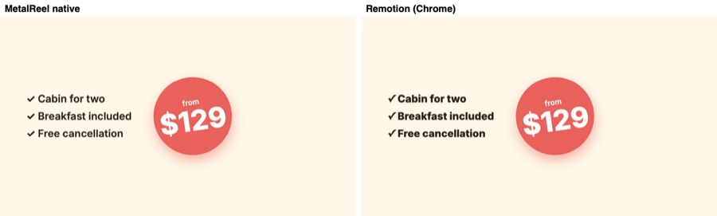 | 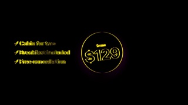 | 2.72 | 2.22 |
| PhotoSlideshow (110) | 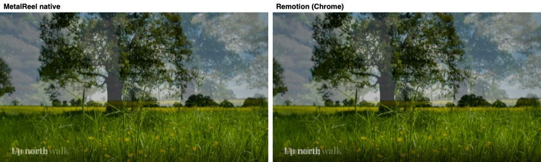 | 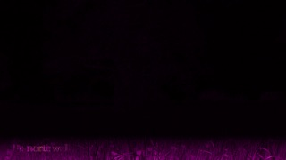 | 1.66 | 1.66 |
| LongForm (4000) | 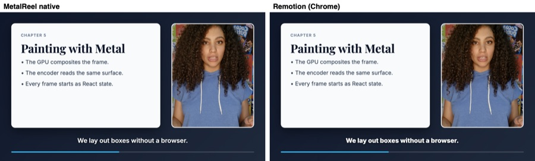 | 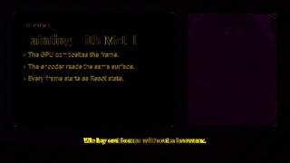 | 2.52 | 2.60 |
| FeatureCheck (90) | 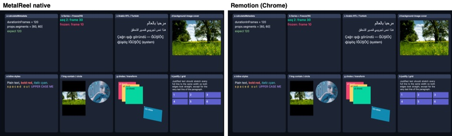 | 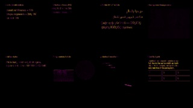 | 0.72 | 5.51 |

MAE is the mean absolute difference per RGB channel (0–255). Both columns are measured against `npx remotion still`.
For scale: re-encoding the Remotion TitleCard frame as JPEG at quality 90 and comparing it with the original gives MAE 0.94 (measured with the same tool). The largest visible difference is the gradient on the Audiogram cover art; hybrid mode on FeatureCheck differs more than native (MAE 5.51 versus 0.72).
<!-- COMPARE:END -->

Reproduce with:

```bash
node scripts/compare.mjs --project examples --hybrid TitleCard:60 TalkingHead:200
```

## Use cases covered by the samples

<p align="center">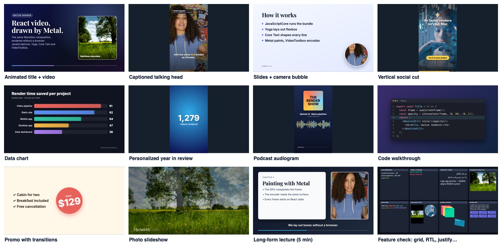</p>

The samples follow what people most often build with Remotion:

- **Captioned talking heads** with word highlights
- **Slides with a camera bubble**
- **Vertical social cuts**
- **Animated titles and promos** using `@remotion/transitions`
- **Data charts**
- **Personalized "year in review"** videos driven by input props
- **Podcast audiograms**
- **Code walkthroughs**
- **Photo slideshows** with a Ken Burns pan
- **A 5-minute long-form lecture layout**
- **A feature check** covering `calculateMetadata`, `Series` with `Freeze`, Arabic and Turkish shaping, justified text, grid, background images, contain/circle image fits and 2D transforms

Each sample is ordinary Remotion code in [`examples/src/compositions`](examples/src/compositions).

<p align="center">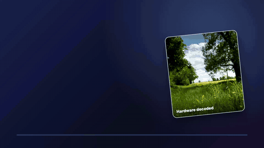</p>

## What makes it different

**🚫 Chrome-free rendering.** Your bundle runs in JavaScriptCore, the engine inside Safari. That includes
`remotion`, `@remotion/*`, Google Fonts loading, `delayRender`, and `calculateMetadata`. No browser process
starts. On the samples this renders 1080p at 118–271 frames per second end to end.

**⚡ Hardware decode and encode, zero copy.** `<OffthreadVideo>` frames are decoded by the Mac's media engine
straight into IOSurfaces. Core Image composites them on Metal and renders into the encoder's own pixel buffer
pool, so VideoToolbox reads the same memory. Video frames are never turned into JPEG or PNG, never piped to
another process, and never decoded twice. Audio is mixed with AVFoundation using the same clip list Remotion
computes, and the result is muxed without re-encoding.

**🌈 HLG / HDR tone mapping that matches Remotion.** iPhone footage is often HLG (BT.2020). Remotion converts
it to SDR with ffmpeg's `zscale → hable → BT.709` chain. MetalReel reproduces that chain as a 64³ LUT on the
GPU, so camera footage has the same brightness as in Remotion. Apple's built-in conversion came out about 10
levels darker in our tests.

**🧩 Automatic WebKit fallback, per element.** If an element can't be painted natively (SVG, `clip-path`,
masks, `drop-shadow`), WebKit renders just that element once, in its own coordinate space. Metal then applies
its animation. In the vertical sample, a pulsing SVG icon was rendered 12 times for 300 frames. The whole
composition stays native, and every project renders correctly from day one.

**🔬 Pixel validation built in.** `scripts/compare.mjs` renders the same frames with Remotion and MetalReel
and reports the mean absolute error. It writes side-by-side and heat-map images, which is how every image on
this page was produced. On the samples the native error is small (MAE 0.61–2.72 on a 0–255 scale); for scale, a JPEG q90 re-encode of one frame measures 0.94.

**🎯 Deterministic frames.** The JavaScript event loop is driven from Swift one task at a time, so React always
commits before Remotion marks a frame ready. The Chrome path needs retries to avoid "stale frames" under load.
Here that race cannot happen.

**🔇 Quiet Mac.** Native mode used 5–41× less CPU time than Remotion on the samples (see the CPU chart), so renders are far less likely to spin up the fans and the machine stays usable.

## Compatibility

| Area | Native | Notes |
|---|---|---|
| Remotion core: `Composition`, `Sequence`, `Series`, `Loop`, `interpolate`, `spring`, `Easing`, `random`, `staticFile`, `delayRender`, `calculateMetadata`, input props | ✅ | runs unchanged in JavaScriptCore |
| `@remotion/transitions`, `@remotion/google-fonts`, `@remotion/noise`, `@remotion/paths` | ✅ | |
| Layout: block, flex (incl. wrap and gap), absolute/relative, `inset`, margins and auto margins, padding, `%`, `em`/`rem`/`vw`/`vh`, `calc()` (simple) | ✅ | Yoga |
| Basic `display: grid`: px, `%`, `fr` and `auto` tracks, `repeat()`, `minmax()`, gaps, auto-placement | ✅ | explicit placement, spans and `auto-fill` print a warning |
| Text: web fonts, weights, italic (synthetic when the font has none), letter-spacing, line-height, alignment including `text-align: justify`, `white-space`, text-transform, text-shadow, mixed inline styles, `<br>`, inline replaced elements (images) on a line box, Arabic/RTL shaping | ✅ | Core Text with Chrome-like line breaking |
| Backgrounds: colors, linear, radial and conic gradients, multiple layers, `background-image: url()` with cover/contain | ✅ | |
| Borders (uniform and single-side), border-radius, box-shadow (incl. inset), opacity | ✅ | per-corner radii use one radius |
| 2D transforms, `transform-origin`, individual `translate`/`rotate`/`scale` | ✅ | 3D transforms are approximated as 2D |
| `filter`: blur, brightness, contrast, saturate, grayscale, sepia, hue-rotate, invert, opacity; `backdrop-filter`; `mix-blend-mode` | ✅ | |
| ``, `<OffthreadVideo>`, `<Html5Audio>`/`<Audio>`, `<OffthreadVideo>` audio | ✅ | |
| SVG, `clip-path`, `mask`, `drop-shadow`, `.svg` images | 🧩 | WebKit fallback for that element, cached |
| `<canvas>`, WebGL / `@remotion/three`, `@remotion/lottie`, `@remotion/skia`, `useAudioData` (Web Audio) | ➡️ | use `--mode hybrid` |
| `className` and CSS files (e.g. Tailwind), inline-block flow, `text-decoration`, `-webkit-text-stroke`, `getBoundingClientRect`, per-corner border radii, real 3D transforms | 🚧 | [roadmap](#roadmap) |

When something is not native, the renderer says so at the end of the render, for example
`[warn] rendered by WebKit (once, then cached): SVG (299×)`.

## How it works

<p align="center">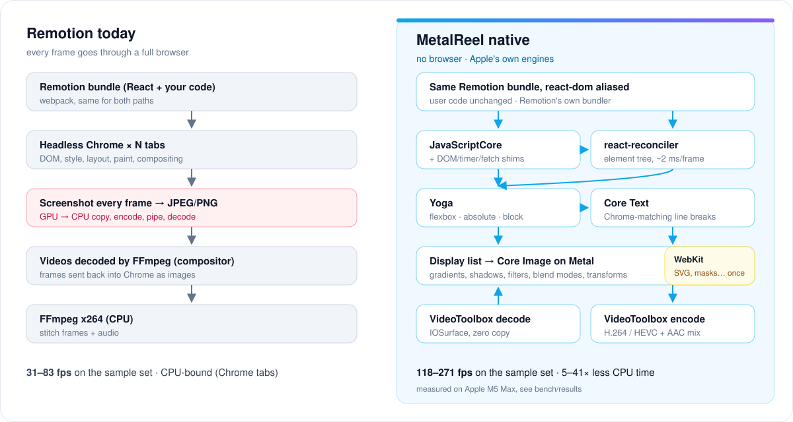</p>

1. **Bundle.** Remotion's own bundler builds your project. The only change is a webpack alias that points
   `react-dom` to MetalReel's renderer. Your `webpack` setup, `staticFile()`, and imports work as usual.
2. **Run.** JavaScriptCore evaluates the bundle on top of a small browser prelude (event loop, DOM nodes,
   `fetch`, `FontFace`). Remotion's own render entry mounts the composition, and `remotion_setFrame()` moves
   it frame by frame.
3. **Lay out.** The element tree goes through CSS inheritance and Yoga flexbox. Text is shaped and broken into
   lines with Core Text, following Blink's rules for whitespace, break opportunities, half-leading, and metric
   rounding.
4. **Paint.** A compact display list (boxes, gradients, shadows, text lines, image and video references)
   becomes a Core Image graph on Metal.
5. **Encode.** VideoToolbox writes H.264 or HEVC, and AVFoundation mixes the audio.

Details are in [docs/ARCHITECTURE.md](docs/ARCHITECTURE.md).

## Roadmap

Not done yet, roughly in order:

- **Stylesheets and `className`:** a CSS cascade for Tailwind and CSS-module projects. Today, inline styles are native.
- **`getBoundingClientRect` and measuring APIs:** feed layout results back to JS for `@remotion/layout-utils` and Code Hike–style measuring.
- **Inline-block flow, text decorations, text stroke, per-corner radii, real 3D transforms**, and the rest of grid (explicit placement, spans, `auto-fill`).
- **Native canvas 2D:** CoreGraphics-backed `CanvasRenderingContext2D`, so canvas compositions stay out of Chrome.
- **Incremental layout:** keep Yoga nodes between frames and re-measure only what changed.
- **Parallel rendering:** several JavaScriptCore contexts with frame ranges, merged in the encoder. *Estimate:* 2–3× more throughput on long videos.
- **ProRes and HDR (HLG/PQ) output, alpha channel output, dual encoders** (both media engines on Max/Ultra chips).
- **Neural Engine features:** on-device transcription for captions, face tracking for automatic reframing, and background removal (Vision / Core ML), exposed as React components.
- **Native components (the React Native model):** heavy, frequently used components can be implemented in Swift and used from TSX like any other component.
- **MetalReel Studio:** a SwiftUI app with a live Metal preview, timeline scrubbing, and hot reload.
- **Lambda-style distribution:** render on a fleet of Macs.

## Remotion license

MetalReel does not include Remotion code. It executes the JavaScript bundle that your project builds with
Remotion. **Your use of Remotion remains subject to the
[Remotion License](https://github.com/remotion-dev/remotion/blob/main/LICENSE.md)**, including the company
license requirement, regardless of which renderer produces the frames. MetalReel is not affiliated with or
endorsed by Remotion. "Remotion" is used only to describe compatibility.

## Credits and license

- MetalReel is MIT licensed ([LICENSE](LICENSE)). Third-party components are listed in [NOTICE.md](NOTICE.md); Yoga (MIT) is vendored.
- Sample media is openly licensed and downloaded on demand; see [ATTRIBUTION.md](ATTRIBUTION.md).
- Contributions are welcome; see [CONTRIBUTING.md](CONTRIBUTING.md).
